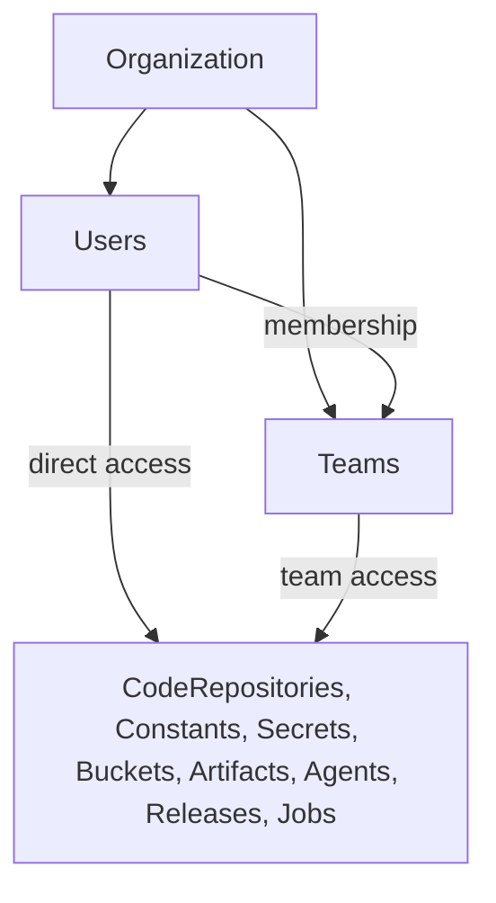

# Users and Access

Main Sequence is built for shared work. CodeRepositories, datasets, application surfaces, constants, secrets, artifacts, and releases are rarely useful for only one person.

That means access control is not an optional admin topic. It is part of how teams build and operate on the platform.

This guide explains the access model in plain language, without implementation details.

For notification delivery rules and client usage, see [Notifications](notifications.md).

To read the policies the platform defines for each kind of shareable object,
with what each one allows, see [Access Policy Catalog](access_catalog.md).
Teams are controlled by policies; see [Teams](#teams) and
[Who Has Access to an Object](object_access.md).

## Start with the right mental model

There are five concepts to keep separate:

1. `Organization`: the tenant boundary
2. `User`: a person who signs in to the platform, or the workload identity a deployed Job, FastAPI release or Agent runs as
3. `Role`: a broad level of responsibility inside the organization
4. `Team`: a reusable group that can hold policies on resources
5. Resource access: the policies that decide who can do what on a specific resource

Most access questions can be reduced to:

- which organization does this belong to
- who is the user
- does the user have a broad admin role
- does the user hold a policy on the resource directly
- does a team the user belongs to hold a policy on the resource

## How the pieces fit together



## Organization

The organization is the main security boundary.

In practice, that means:

- users belong to one organization
- teams belong to one organization
- resources are usually visible only inside that organization
- access is designed around collaboration inside the same tenant, not across tenants

This is why the first access question is usually not "what role does this person have?" but "are they even in the same organization?"

## User

A user is the person operating on the platform.

Users are the identities that:

- sign in
- create resources
- run commands through the CLI
- receive direct access to resources
- belong to one or more teams

When you give a user a policy on a resource directly, you are saying:

> this specific person should be able to do what this policy allows on this specific thing

That is the most explicit form of access.

## Workload identities

A deployed Job, FastAPI release or Agent runs as its own User: its workload
identity. A workload identity belongs to the Organization like a person, but it
is not a person: other Users see no username, email, join date or first and
last name for it.

Any member of the Organization can read a workload identity by its UID, for
example to check the caller of a request an application received:

```python
from mainsequence.client import User

user = User.get_by_uid(user_uid)

user.identity_type          # "workload"
user.is_active
user.job_uid                # the Job it belongs to, or None
user.resource_release_uid   # the release it belongs to, or None
user.agent_uid              # the Agent it belongs to, or None
user.username, user.email   # None for a workload identity
```

For a workload identity the platform sends `uid`, `identity_type`, `is_active`,
`job_uid`, `resource_release_uid` and `agent_uid`. The `User` fields it does not
send are `None`, or empty for lists.

To go the other way, from a workload to its identity, read
`workload_user_uid` on the `Job`, `ResourceRelease` or `Agent`. It is `None`
when the object has no workload identity, for example a static-site release,
a release's backing Job, or an Agent without a runtime release. An Agent and
its runtime release report the same value.

```python
from mainsequence.client import Job, User

job = Job.filter(name__contains="nightly-prices")[0]
user = User.get_by_uid(job.workload_user_uid)  # identity_type == "workload"
```

`User.filter()` lists people only. Ask for workload identities with the
`identity_type` filter; the listing holds the ones you can view:

```python
workloads = User.filter(identity_type="workload")
```

Both listed rows and UID lookups carry `workload_name`, the name of the Job,
release or Agent, when you can view the workload. It is `None` for a workload
you cannot view, for a person, or when the response does not carry it.

`identity_type` is one of `human`, `service_account`, `deleted_user` and
`workload`. A person's row may not carry it, so test for `"workload"` rather
than for `"human"`.

Inside a FastAPI request, an application can read the directory as its caller
sees it with `reads_as_caller()`: `User.filter(search=...)` then finds people by
email or name and workloads by their Job, release or Agent name, and each
workload row carries `managed_by_caller`. See
[Reading the directory as the caller](../fastapi/index.md#reading-the-directory-as-the-caller).

The access methods take a workload identity like any other User. An
application that received a request from a workload can give that workload a
policy on its own objects, and the platform decides whether the grant is
allowed:

```python
caller = User.get_logged_user()
user = User.get_by_uid(caller.uid)
if user.identity_type == "workload":
    # any object the application created, here an Artifact
    artifact.attach_policy("viewer", principal_type="user", principal_uid=user)
```

## Applications that act for their requester

An application's own access comes from the policies its workload User holds:
give that User policies on objects as you would a person. Those policies cover
every call the application makes for itself.

An application can instead be enabled to act for its **requester**, the person
whose own request it is serving, with the platform setting
`acts_for_requester`:

- It is `false` by default. Nothing changes for an application that leaves it
  off.
- Only Organization admins enable it: after the application exists, with
  `PATCH /api/v1/workload-users/<workload_user_uid>/`, or in code, by declaring
  `acts_for_requester: true` on the resource in the repository workflow file.
  A declaration turns it on only when the person who pushed it is an
  Organization admin; otherwise that resource fails before it deploys. A push
  made by a bot right after an admin's push, for example a GitHub Actions
  release job that commits the next version, keeps that admin's authority when
  it leaves the workflow file unchanged. Once the declaration has turned it on,
  later pushes of the same declaration keep it on, whoever pushes.
- An application that should act only for people, for example a data analyst
  Agent, holds no grants of its own.

The platform applies one rule to every call an Agent makes for its work:

| Request | Permissions used |
| --- | --- |
| No delegation | The caller's own ordinary permissions: a person, or the calling workload |
| Valid delegation | The person's ordinary permissions, including administrative ones |
| Invalid or expired delegation | None: the call is rejected, never switched to another identity |

Requester-bound access covers the reads, creates, updates, runs, access
changes and deletes the person may make through supported operations. Every
operation is checked against that person, never against the acting Agent's
grants, and the two are never combined.

The access lasts at most 24 hours after the person's original request, and only
while the turn or Task serving it runs. The platform checks it again on every
call and refuses operations that do not support requester-bound access.

Platform-authorized Agent-to-Agent delegation keeps the person who started the
work and the original request time. Each delegated Agent must itself be enabled
to act for its requester; delegation cannot select another person, increase
their permissions or restart the 24-hour limit. A receiving application cannot
forward its inbound assertion to create another requester binding.

The platform decides which operations support requester-bound access. Updating
the SDK does not enable an operation or turn a refused call into the
application's own call.

Nobody names the requester in a request. An application never accepts a
person's UID from a request body, header or query parameter: the person comes
only from the platform. An application that receives a requester-bound call
reads the requester with `User.get_requester()`, the person's own `uid` and
`is_organization_admin`, asks about the person's teams with `in_teams()`, and
checks that person's permission
for the exact object and operation, for reads and writes alike. Each handler or
tool decides whether it needs a person; see
[Requester-bound calls](../fastapi/index.md#requester-bound-calls).

### What people are told

Every client that shows an application with `acts_for_requester` shows the
platform's statement, exactly:

> **This Agent works with your identity.** It can read, create, change, run, share or delete only what your permissions allow through supported operations, only while serving your request, and for at most 24 hours after you ask. It uses your ordinary permissions, including administrative permissions, and access is checked on every call. Your Organization's administrator approved it to work this way.

Do not paraphrase or shorten it, and do not describe such an Agent as
read-only or promise that it cannot change, share or delete anything.

The plain risk: a model-driven Agent can be steered by prompt injection. Its
reads and writes can reach as far as the person's ordinary permissions allow,
administrative ones included, such as changing who has access to accessible
objects or deleting them through supported operations, for at most 24 hours
after the original request.
A read grant does not authorize a write. This is why only Organization admins
decide which Agents may act for people, and why every operation still needs its
own authorization check.

## Roles

Roles are the broad, organization-level classification of what kind of platform user someone is.

For most practical workflows, the important roles are:

- `Organization Admin`
- `Dev User`
- `Light User`

Use roles to think about broad responsibility:

- who can administer the organization
- who is expected to build and maintain workflows
- who mostly consumes outputs

Do not use roles as your mental model for day-to-day access.

Why:

- roles are coarse
- real collaboration usually happens at the resource level
- two users with the same broad role may still need access to very different CodeRepositories, tables, or application surfaces

So the safe rule is:

- roles define broad responsibility
- the policies on each resource define actual resource access

## Teams

Teams are reusable groups of people and workload identities inside one organization.

Use a team when the same set of people should repeatedly receive access to the same class of resources.

Examples:

- `Research`
- `Platform`
- `Risk`
- `Execution`
- `Client Reporting`

Teams are useful because they let you give access once and reuse that decision many times.

Instead of giving five people policies on several application resources and datasets one by one, you can give those policies to one team and manage membership there.

Team members and creators can be people or workload identities. Their summaries
carry `uid` and, when supplied, `member_kind` (`"person"` or `"workload"`). For
workloads, `username`, `email`, `first_name` and `last_name` are `None` when
omitted or null in the response. Use `uid` for identity, not personal fields.

### Membership and control

A team has two separate things:

- **Membership** is who is in the team: who receives the policies the team holds.
- **Control** is the policies on the team, which decide who can see it, change
  its members, edit it or delete it.

Any person can create a team, and the creator becomes its owner and its first
member. The policies on a team are:

| Policy | What its holder can do |
| --- | --- |
| `viewer` | See the team and who is in it |
| `membership_manager` | See the team and its members, add people and workload identities, and remove members |
| `editor` | See the team and its members, rename it, change its description, activate or deactivate it, and see its policies |
| `owner` | Everything on the team, including deleting it and deciding who manages it |
| `member` | Held by every member and never attached: see the team and its members, and leave it |

Controlling a team does not require being a member, and being a member gives no
control beyond `member`. Organization admins hold every action on every team of
their organization. Each policy's full description is in the
[Access Policy Catalog](access_catalog.md):
`mainsequence access policies --type organization-teams`.

The built-in full-directory team is computed: its members are every active
person of the organization. Nobody adds, removes or leaves its members, edits
or deletes it, and only Organization admins give its `viewer` policy, which
shows every active team of the organization and its members.

### Manage members in Python

```python
from mainsequence.client import Team

team = Team.create(name="Research", description="Model validation")
team.allowed_actions                 # your actions on the team: every one, as its owner

team.list_member_candidates(search="ana")
team.add_member(user_uid)
team.list_members()
team.remove_member(user_uid)
team.list_held_access()              # the policies the team holds on other objects
team.leave()
```

| Method | Route | Returns |
| --- | --- | --- |
| `Team.create(name=..., description="", is_active=True)` | `POST /api/v1/teams/` | the new `Team`, with `members` and `allowed_actions` |
| `list_members()` | `GET /api/v1/teams/{uid}/members/` | `list[UserSummary]`: people first, then workload identities |
| `add_member(user_uid)` | `POST /api/v1/teams/{uid}/members/` | the member's `UserSummary`; adding a member again changes nothing |
| `remove_member(user_uid)` | `DELETE /api/v1/teams/{uid}/members/{user_uid}/` | `None` |
| `leave()` | `POST /api/v1/teams/{uid}/leave/` | `None` |
| `list_member_candidates(identity_type=None, search=None)` | `GET /api/v1/teams/{uid}/member-candidates/` | `list[UserSummary]`: who you may add and is not a member yet, at most 200 |
| `list_held_access()` | `GET /api/v1/teams/{uid}/held-access/` | `list[TeamHeldAccess]`: each policy the team holds on an object you can read |

Every method also takes `timeout`, and a `user_uid` can be a UID or an object or
a dict that carries it as `uid`, such as a `User`.

- `Team.get_by_uid()` and `Team.create()` return a team's detail, which carries
  `allowed_actions`, the ids of your actions on it such as
  `organization-teams.update`. Listed teams carry `None`.
- Adding needs the team's `add_member` action. An Organization admin can add any
  person or workload identity of the organization; anyone else can add people
  who share an active team with them, themselves, and the workload identities
  they can view. Anyone else raises `BadRequestError` with `code`
  `invalid_user_uids`.
- Removing needs `remove_member`, or `leave` to remove yourself. Removing
  someone who is not a member raises `NotFoundError`.
- Leaving ends your membership only: a policy you hold on the team, such as
  `owner`, stays. Leaving a team you are not a member of raises
  `BadRequestError` with `code` `not_a_team_member`.
- `list_member_candidates()` lists people by default; `identity_type="workload"`
  lists workload identities, and `search` matches an email or a name.
- A `TeamHeldAccess` row has the `binding_uid`, the object's `resource_type`,
  `object_uid` and `object_name`, the `policy` id the team holds, its `source`,
  `granted_by` (an `AccessPrincipal`) and `created_at`: what joining the team
  gives a member.

### Decide who controls a team

The policies on a team are read and changed with the access methods every
object with access routes has:

```python
team.get_access()                    # bindings, and the computed access of admins and members
team.attach_policy("membership_manager", principal_type="user", principal_uid=user_uid)
team.detach_policy(binding_uid)
team.explain_access("organization-teams.update", principal_uid=user_uid)
```

See [Who Has Access to an Object](object_access.md) for every method, the
models and the errors. A refused request raises `PermissionDeniedError`, whose
`payload` names the `required_action` and the `granting_policies`.

### From the command line

```bash
mainsequence organization teams create Research --description "Model validation"
mainsequence organization teams members list <TEAM_UID>
mainsequence organization teams members add <TEAM_UID> <USER_UID>
mainsequence organization teams members remove <TEAM_UID> <USER_UID>
mainsequence organization teams leave <TEAM_UID>
mainsequence organization teams access list <TEAM_UID>
mainsequence organization teams access grant <TEAM_UID> membership_manager --user <USER_UID>
mainsequence organization teams access revoke <TEAM_UID> <BINDING_UID>
mainsequence organization teams access explain <TEAM_UID> organization-teams.update --user <USER_UID>
```

See [Teams](../../cli/index.md#teams) in the CLI reference.

## What team membership means

If a user belongs to a team, they inherit the policies that team holds on resources.

That is the core idea.

Membership means:

- the user is part of that team for access purposes
- the user receives inherited access through the policies the team holds
- the user holds the team's `member` policy: they can see the team and its members, and leave it

Membership does not automatically mean:

- the user can manage the team
- the user can change who else is in the team
- the user can change who controls the team
- the user can administer every resource the team can see

That distinction matters a lot.

Being inside a team means the user benefits from the team's access. Managing the team itself comes from the policies on it.

## Resource access

Main Sequence decides access to every shareable resource with policies.

That is the practical layer that answers:

- who can see or use this resource
- who can change it
- who decides who has access

Each kind of resource has its own policies, from narrow ones for consumers to
`owner`, which also decides who has access. A policy goes to a person, a
workload identity or a team on one resource; see
[Who Has Access to an Object](object_access.md) and the
[Access Policy Catalog](access_catalog.md):

- a constant's `reader`, `editor` and `owner`, a secret's `reader`,
  `value_reader`, `editor` and `owner`, and a bucket's `reader`, `contributor`,
  `editor` and `owner`; see
  [Who can use a constant](constants_and_secrets.md#who-can-use-a-constant),
  [Who can use a secret](constants_and_secrets.md#who-can-use-a-secret) and
  [Who can use a bucket](artifacts.md#who-can-use-a-bucket);
- an Artifact's `viewer`, `editor` and `owner`; see
  [Who can use an Artifact](artifacts.md#who-can-use-an-artifact);
- a code repository's, a branch's and a Project's `reader`, `editor` and
  `owner`, where a repository's or a Project's policies pass down to its
  branches, and using a repository or a branch also needs the platform's `user`
  product role; see
  [Code Repositories, Branches and Projects](code_repositories.md);
- an Agent's `viewer`, `user`, `operator`, `editor` and `owner`; see
  [Agents](agents.md);
- a release's `viewer`, `user`, `editor` and `owner` and a Job's `viewer`,
  `runner`, `editor` and `owner`, which also take the policies of the branch
  that declares them, or of the Agent or the release they back; see
  [Who can use a release](resource_releases.md#who-can-use-a-release) and
  [Who can use a Job](scheduling_jobs.md#who-can-use-a-job);
- a model-provider credential's and a custom model provider's `user`, `editor`
  and `owner`, which decide who sends requests through them and who maintains
  them.

The same pattern shows up again and again:

- some people can see or use a resource
- some people can maintain it
- few people decide who has access
- access may come directly, through a team, or from a resource above it

## Direct access vs team access

There are two common ways a user gets access to a resource.

### Direct access

A policy on the resource goes straight to a user.

Use this when:

- the access is personal
- the resource is unusual or one-off
- you do not want to create or reuse a team for it

### Team access

A policy on the resource goes to a team, and all current team members inherit that access.

Use this when:

- several people need the same access
- access should stay aligned as people join or leave the team
- you want one reusable access boundary instead of many manual grants

## Consumers vs maintainers

Most of the time, the practical distinction is simple:

- consumers get the narrowest policy that lets them inspect or use the
  resource, such as `reader`, `viewer` or `user`
- maintainers get `editor`, which also changes and deletes it
- only the people who decide who has access get `owner`

For example:

- on a release, `user` calls the application without seeing its logs, and
  `viewer` also reads them
- on an Artifact, `editor` replaces or deletes its file

This is the cleanest engineering split:

- consumers get a reading or using policy
- maintainers get `editor`

## The subtle but important rule about teams

This is the part people most often get wrong:

> a team can hold policies on resources, but being a member of the team does not automatically make you an administrator of the team itself

In other words:

- if `Research` holds a policy on a dataset, members of `Research` inherit access to that dataset
- that does not automatically mean every member of `Research` can manage the `Research` team

This is why "team membership" and "team administration" should be thought of as separate concerns: membership is who is in the team, and administration is the policies on it.

## Practical examples

### Example 1: Give a team access to a dataset

If `Research` holds `viewer` on an `Artifact`:

- current members of `Research` can read the dataset
- future members of `Research` will also inherit that read access
- removing someone from `Research` removes that inherited path

### Example 2: Let one person maintain a dataset directly

If one workflow maintainer needs to manage a dataset directly:

- attach `editor` on the `Artifact` to that user
- do not widen access for the whole team unless that is actually intended

### Example 3: Team membership is not team administration

If Alice is a member of `Research`:

- Alice inherits the access `Research` holds on resources
- Alice can see `Research` and its members, and leave it
- changing who is in `Research` needs its `membership_manager` or `owner` policy
- renaming or deactivating `Research` needs its `editor` or `owner` policy, and deciding who controls it needs `owner`

### Example 4: A team that maintains a resource does not have unlimited control

If `Team A` holds `editor` on a release or a dataset:

- members of `Team A` can change and delete that resource
- that does not automatically mean they can change every access rule everywhere else on the platform

Keep your thinking resource by resource.

## How access fits the platform workflow

The same resource-scoped pattern applies across the platform:

- `CodeRepository`, its branches and Projects control access to code and to
  what runs from it
- `Constant` and `Secret` control access to runtime configuration
- `Bucket` and `Artifact` control access to stored files
- `Agent` controls who talks to an Agent and gives it Tasks
- `ResourceRelease` controls access to supported deployed experiences such as APIs
- `Job` controls who runs scheduled work and reads its runs

That is why RBAC appears early in the Main Sequence workflow. The moment a resource becomes useful to other people, access design becomes part of the engineering work.

## Rules of thumb

- start with the organization boundary first
- use roles for broad responsibility, not detailed resource access
- use teams for repeatable access patterns
- give access directly for exceptional or personal cases
- give the narrowest policy that does the job, and `owner` only to those who decide who has access
- do not assume team membership means team administration
- think in terms of resource boundaries: CodeRepository, dataset, secret, bucket, artifact, Agent, release, Job

For related configuration guidance, see
[Constants and Secrets](./constants_and_secrets.md).


## Identity facts for application authorization

User detail and current-user responses may supply `is_organization_admin`
(a strict boolean) and `active_team_uids` (active Team UUIDs). They are facts
computed by the platform; the SDK does not infer roles from group names or
implement an application's resource grants. Missing fields remain `None`, so
applications requiring these facts must fail closed rather than assume access.

Use `User.get_authenticated_user_details()` for the process user and
`User.get_by_uid(uid)` for an already verified application caller, subject to the
existing platform directory permissions. These are ordinary User reads; they do
not change the process identity or caller assertion contract. Refresh facts at
the application's authorization boundary to apply Team/admin changes.

The caller can be a person or a workload identity; see
[Workload identities](#workload-identities) for what the lookup returns for a
workload.
